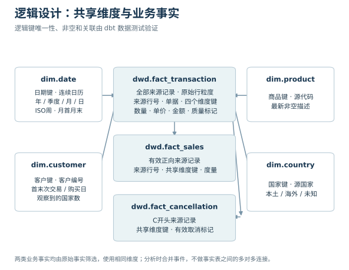

# 在线零售数仓模型设计

梁宁炜负责概念、逻辑和物理设计，以及 DIM/DWD 开发。模型围绕 UCI Online Retail 的交易明细，使用星型结构组织分析数据。

## 3 概念设计

业务过程是一位客户在某时刻发生一笔单据交易，单据包含一条或多条商品明细。分析对象为交易记录，分析角度为日期、商品、客户和国家。

这里的“国家”直接取自交易记录的 Country 字段。源站将其解释为客户居住国家，但同一客户历史记录可能出现不同国家，因此模型将国家放在每条事实记录上，不把一个固定国家写死在客户维度中。

一张单据可包含多个商品，同一单据、同一商品也可能出现多条记录。源文件没有可靠的单据行号，所以使用 Excel 的来源行号作为这份固定源文件中的技术主键。`InvoiceNo + StockCode` 不作为唯一键。原始八字段完全一致的记录也先保留并标记，不能仅凭内容一致断言是真实重复业务。

核心关系如下：

- 一个日期对应多条交易记录。
- 一个商品对应多条交易记录。
- 一个客户对应多条交易记录，缺失客户统一关联未知成员。
- 一个国家对应多条交易记录。
- 单据编号直接保留在事实表，作为退化维度，用于订单去重和明细追溯。

概念边界：数据中同时存在正常销售、取消和其他异常记录。明细事实保存全部来源行，应用层使用统一的正向销售标记选择统计范围。

源 `StockCode` 还包含邮资、手工记账、调整等业务项目，因此本模型的“商品维度”实际覆盖所有来源项目代码。看板采用“商品与业务项目”名称；主金额指标展示为“正向交易金额”，数量指标展示为“记录数量合计”。后者不能直接解释为纯实物商品销量。这些项目按源代码保存在商品维度中。

## 4 逻辑设计

### 建模方法与粒度

采用 Kimball 维度建模思路：选择销售交易业务过程，声明来源交易明细行粒度，识别日期、商品、客户、国家维度，记录数量、单价和行金额事实。

中心事实表为 `dwd.fact_transaction`。一行对应 `Online Retail.xlsx` 中的一条来源交易明细，**不是一个订单、一个客户或一个商品日汇总**。四张独立维度表围绕事实表形成星型结构，模型图的 Mermaid 源文件见 `docs/model.mmd`，可直接查看的矢量图为 `docs/model.svg`。

### 数仓分层

| 层 | 职责 | 本项目对象 |
|---|---|---|
| ODS | 保存源数据、来源文件和来源行号，支持追溯 | `ods.retail_raw` |
| STG | 实现可复用的类型规范、异常和重复标记 | `stg.clean_transactions` |
| DIM | 提供分析维度与技术键 | `dim.date`、`dim.product`、`dim.customer`、`dim.country` |
| DWD | 保存可关联的原子交易事实 | `dwd.fact_transaction` |
| DWS | 按日与主题维度预汇总可累加金额和数量等 | 日国家、日商品国家、日客户国家汇总表 |
| ADS | 为看板提供筛选和指标查询 | 应用视图与统一查询接口 |

STG 是实现上的中间处理层，不代替 ODS/DWD/DWS/ADS。DIM 是被事实层共享的维度层，不意味着数据必须按一条直线依次经过所有层。

### 日期维度 `dim.date`

| 字段 | 类型 | 说明 |
|---|---|---|
| date_key | INTEGER PK | 正常日期键采用 YYYYMMDD，未知日期为 0 |
| full_date | DATE UNIQUE | 日期；未知成员为 NULL |
| year | INTEGER | 公历年 |
| quarter | INTEGER | 季度 1—4 |
| month | INTEGER | 月份 1—12 |
| day | INTEGER | 月内日期 |

生成最小与最大有效交易日期之间的连续日历，即使某日没有交易，该日也存在于日期维度。未知成员的日历属性均为 NULL。

### 商品维度 `dim.product`

| 字段 | 类型 | 说明 |
|---|---|---|
| product_key | BIGINT PK | 代理键，0 表示未知商品 |
| stock_code | VARCHAR UNIQUE | 源商品代码，不强制转成数字，保留非数字编码 |
| description | VARCHAR NOT NULL | 按时间最新的非空商品描述；同时间按来源行号确定性选择 |

同一商品代码有多个名称时，选择最新的非空描述。若所有描述为空，则展示“商品名称缺失”。零号维度成员展示“未知商品”。

### 客户维度 `dim.customer`

| 字段 | 类型 | 说明 |
|---|---|---|
| customer_key | BIGINT PK | 代理键，0 表示未知客户 |
| customer_id | VARCHAR UNIQUE | 源客户编号；未知成员为 NULL |

客户维度仅保存数据真正提供的客户编号。未知客户交易可以计入销售额，但未知成员不计入购买客户数，不出现在实名编号客户排行中。

### 国家维度 `dim.country`

| 字段 | 类型 | 说明 |
|---|---|---|
| country_key | BIGINT PK | 代理键，0 表示未知国家 |
| country | VARCHAR UNIQUE NOT NULL | 源国家名称；缺失时为“未知国家” |

### 交易事实表 `dwd.fact_transaction`

| 字段 | 类型 | 说明 |
|---|---|---|
| source_row_number | BIGINT PK | Excel 来源行号，从 2 开始，保留唯一追溯标识 |
| invoice_no | VARCHAR | 单据编号，退化维度；保留取消前缀，不强制转为数字 |
| invoice_ts | TIMESTAMP | 源交易时间，保留原始值 |
| date_key | INTEGER NOT NULL | 关联日期维度；未知取 0 |
| product_key | BIGINT NOT NULL | 关联商品维度；未知取 0 |
| customer_key | BIGINT NOT NULL | 关联客户维度；未知取 0 |
| country_key | BIGINT NOT NULL | 关联国家维度；未知取 0 |
| quantity | BIGINT | 源数量，保留负数和空值 |
| unit_price | DECIMAL(18,4) | 单价，单位英镑 GBP，保留四位小数 |
| line_amount | DECIMAL(20,4) | 数量 × 单价；无法计算时为 NULL |
| is_cancelled | BOOLEAN NOT NULL | 源单据编号以 C 开头，忽略大小写 |
| is_positive_sale | BOOLEAN NOT NULL | 满足团队统一正向销售条件 |
| is_exact_duplicate | BOOLEAN NOT NULL | 原始八字段完全相同组中第二条起标记；仍保留 |

正向销售条件由清洗SQL统一生成：单据和商品编号非空、日期有效、数量大于0、单价大于0，且不是取消单据。事实表沿用清洗层的标记。

### 可加性与指标边界

- `line_amount` 和 `quantity` 在相同正向销售口径下可跨日期、商品、国家累加。
- 单价不可直接求和；平均订单金额也不可直接平均，应由筛选后总销售额除以去重订单数。
- 订单数和购买客户数是去重计数，跨日、跨商品、跨国家汇总时通常不可直接相加。
- 正向销售额不扣除取消记录，不等于扣除取消后的净金额。
- 这里的正向销售额在界面称为正向交易金额，因为它包含来源数据中的非实物业务项目；`units` 在界面称为记录数量合计。
- 主看板指标没有自动剔除被标记的完全重复记录。这些记录通过质量标记区分。

## 5 物理设计

### 存储与命名

选用 DuckDB 本地持久化数据库，路径为 `data/warehouse/retail.duckdb`。使用 `ods`、`stg`、`dim`、`dwd`、`dws`、`ads` schema 区分职责。SQL 文件按 `10_clean.sql → 20_model.sql → 30_marts.sql` 执行。建模 SQL 只重建本项目的四张维度表和一张明细事实表，不删除整个数据库或其他 schema。

### 数据类型与约束

标识字段使用字符串，避免损失字母前缀和代码含义；行号和代理键使用整数；交易时刻使用 TIMESTAMP；金额使用定点 DECIMAL，避免直接使用浮点数累加产生金额误差。界面展示时可以四舍五入到两位小数，底层保留四位。

主键、业务键唯一性、必要非空约束和代理键非负检查由物理表声明。维度关联是逻辑外键；本教学实现不声明 DuckDB 物理外键，避免每次替换维度表时被旧事实表依赖阻断。完整流水线必须通过关联孤儿数为0、源行数与事实行数一致、主键唯一性等数据检查后才发布新库。流水线在临时数据库中完成重建，校验通过后替换正式数据库。

### 更新策略

采用单一历史数据集的离线全量重建。商品名称采用 SCD Type 1 的简化实现，即最新非空描述覆盖旧展示名称；不保存名称历史区间。事实中的原始交易时间、金额和来源行号仍可追溯。原始名称在 ODS 中保留。

代理键按业务代码排序分配，在相同输入下确定；新增业务代码后代理键可能发生变化，因此 DIM、DWD 和下游汇总必须作为一个完整批次重建，外部系统不应长期保存这些代理键。

### 查询与存储

DuckDB 使用列式存储，DWS 将常用查询按主题和日期预先汇总。当前数据保存在一个数据库文件中。

### 验证清单

1. 同一份输入执行建模SQL两次，事实行数与各维度业务内容一致。
2. 事实表的来源行号无重复，行数等于 STG。
3. 四个维度关联的孤儿记录数均为0。
4. 未知维度成员存在，缺失客户仍保留交易行。
5. 正向销售行金额与 STG 原始公式一致；取消与异常行未混入该指标。
6. 维度连接不放大事实行数；商品名称选择具有确定性。
7. 模型边界测试使用独立的内存数据库。

### 真实数据验证结果

从原始 Excel 执行 ODS、清洗和建模后，各表记录数如下。

| 对象 | 实际行数 | 说明 |
|---|---:|---|
| `dim.date` | 375 | 包含 374 个连续日期与 1 个未知成员 |
| `dim.product` | 4,071 | 包含 4,070 个商品代码与 1 个未知成员 |
| `dim.customer` | 4,373 | 包含 4,372 个客户编号与 1 个未知成员 |
| `dim.country` | 39 | 包含 38 个源国家值与 1 个未知成员 |
| `dwd.fact_transaction` | 541,909 | 与来源记录数一致，未因连接放大或丢失 |

四个维度的关联孤儿数均为 0。正向销售行金额之和为 GBP 10,666,684.5440；界面展示两位小数时为 GBP 10,666,684.54。此值采用保留完全重复来源行的统一正向销售口径，不含取消单据，不等于净收入。

模型边界测试 `tests/test_model.py` 共 5 个测试函数通过，覆盖缺失维度、连接不放大、最新非空商品名称、一个客户跨国家交易、定点金额、取消记录与完全重复记录保留、重复重建确定性和空输入。人工测试夹具与真实数据流水线相互独立。
