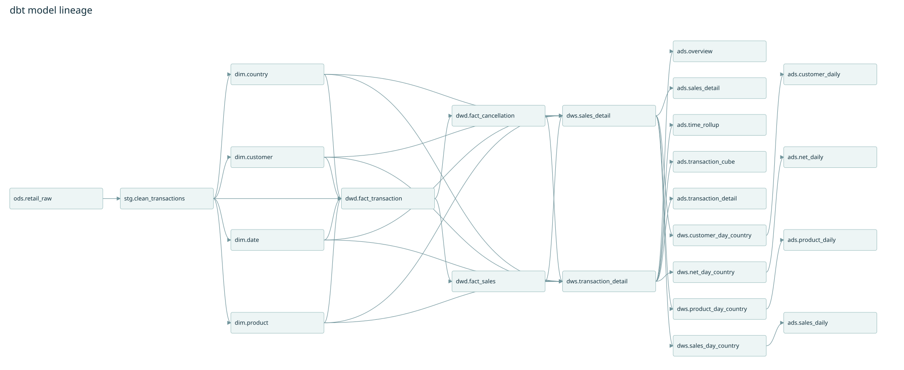

# 在线零售数仓模型设计

我们采用 Kimball 维度建模方法，将销售和取消两个业务过程组织为共享维度的事实模型。梁宁炜负责概念、逻辑、物理设计及 DIM / DWD 开发。

## 概念设计与总线矩阵

一张单据包含多条商品或业务项目记录。源数据没有可靠的单据行号，原始 Excel 行号 `source_row_number` 是本批快照的行标识；`InvoiceNo + StockCode` 不假定唯一。

| 业务过程 | 事实粒度 | 日期 | 商品/业务项目 | 客户 | 国家 | 退化维度 |
|---|---|---|---|---|---|---|---|
| 销售 | 一条有效正向来源记录 | ✓ | ✓ | ✓ | ✓ | InvoiceNo |
| 取消 | 一条 C 开头来源记录 | ✓ | ✓ | ✓ | ✓ | InvoiceNo |

原始事实 `dwd.fact_transaction` 保留全部 541,909 行；业务事实 `dwd.fact_sales` 保留 530,104 条有效正向记录，`dwd.fact_cancellation` 保留 9,288 条取消记录，并用 `is_valid_cancellation` 标记可以计算取消金额的记录。两个业务事实不直接互相连接，通过 `UNION ALL` 形成带交易类型的分析明细，避免关联放大。

## 共享维度

| 表 | 关键属性 | 规则 |
|---|---|---|
| dim.date | full_date、year、quarter、month、day、iso_week、iso_year、iso_weekday、is_weekend、month_start、month_end、year_month | 连续日历，年→季度→月→日；ISO 周配合 ISO 年使用 |
| dim.product | stock_code、description | 最新非空名称；同时间按来源行号确定 |
| dim.customer | customer_id、first/last_transaction_date、first/last_purchase_date、observed_country_count、is_unknown | 日期和国家数从当前完整快照计算 |
| dim.country | country、is_home_market、market_type | 英国为本土，其余已知国家为海外，缺失为未知 |

每张维度都有键值为 0 的未知成员。国家取自每条交易记录，不固定绑定客户。客户属性是全快照描述，不能当作交易当时已经知道的信息。商品编号包含邮资、人工调整等业务项目，未另行猜测商品分类。

## 分层与表

| 层 | 对象 | 职责 |
|---|---|---|
| ODS | retail_raw | 保留八个源字段、文件名、哈希和行号 |
| STG | clean_transactions | 类型规范、空值和质量标记 |
| DIM | date、product、customer、country | 共享维度 |
| DWD | fact_transaction、fact_sales、fact_cancellation | 全部来源事实与两类业务事实 |
| DWS | sales_detail、transaction_detail；sales/product/customer/net_day_country | 主题明细与日汇总 |
| ADS | sales/transaction_detail；sales/product/customer/net_daily；overview；transaction_cube；time_rollup | 看板明细、应用结果表及多层汇总 |

全部 23 个 dbt 模型物化为表，ODS 由 Python 导入。依赖通过 `ref()`、`source()` 声明，dbt 按依赖顺序执行，不依靠文件名顺序。

## 物理设计与更新

DuckDB 文件为 `data/warehouse/retail.duckdb`，六个 schema 对应各层。编号使用 VARCHAR；行号、代理键和数量使用整数；源时间使用 TIMESTAMP；单价 DECIMAL(18,4)，行金额 DECIMAL(20,4)。

键唯一性、非空和维度关联通过 dbt 数据测试执行。这里的主键、外键是逻辑关系，表由 dbt 的 SELECT 物化，不额外声明数据库级主外键约束。流水线先构建临时库，测试通过才发布；同一数据库的构建使用文件锁。

采用全量重建。商品描述按当前快照选择最新非空值，原始名称保留在 ODS。代理键按自然键排序，相同输入结果确定；所有维度、事实和汇总表一起更新。

## 多维汇总

`ads.transaction_cube` 使用 `CUBE(month_start, country, entry_type)` 生成 8 种维度组合，共 931 行；`ads.time_rollup` 使用 `ROLLUP(year, quarter, month)` 生成月、季度、年和总计，共 21 行。

`GROUPING` 和 `GROUPING_ID` 区分汇总成员与普通值。查询每次只选择一个层级，不能把不同层级的金额一起相加。订单和客户在每个组合内重新去重，不累加下层去重数。完整范围可读取物化立方体；任意日期切片先过滤事件明细，再计算相应组合。

## 模型文档与验证

`docs/dbt/index.html` 是流水线生成的 dbt 模型文档，包含字段、SQL 和依赖图；`docs/lineage.svg`、`docs/lineage.mmd`、`docs/lineage.json` 从同一份 manifest 导出依赖关系。

验证覆盖来源行守恒、键唯一、维度关联、金额一致、销售与取消互斥、净额恒等式及立方体总计。Python 测试进一步独立核对全部 8 个 CUBE 层级、日期切片、取消单独存在的区间和模型边界。

